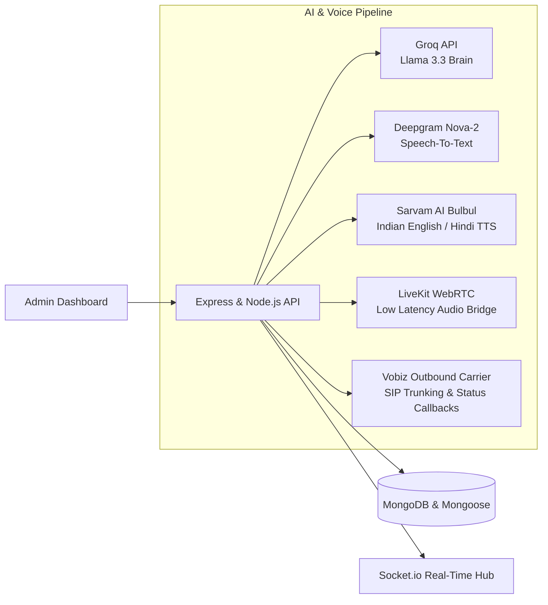

# NexusVoice AI — Autonomous Outbound Voice Calling SaaS Platform

A production-oriented, full-stack MERN AI Voice Calling Platform designed for modern enterprises. It allows administrators to import contact leads, configure multi-lingual voice agents with hyper-realistic voices, manage calling campaigns, and autonomously place outbound phone calls powered by conversational AI.

---

## 🌟 Key Architecture & Capabilities



### 1. Technology Stack
- **Frontend**: React 19, Vite, Tailwind CSS v4, React Router DOM v7, Recharts, Lucide React Icons, Axios, Socket.io-client.
- **Backend**: Node.js, Express.js, MongoDB, Mongoose, JWT Authentication, bcryptjs, Multer, XLSX, ExcelJS, Helmet, CORS, Morgan, Express-Rate-Limit.
- **AI & Voice Infrastructure**:
  - **LLM Brain**: Groq API (`llama-3.3-70b-versatile`)
  - **Speech-to-Text**: Deepgram Nova-2 API
  - **Text-to-Speech**: Sarvam AI (`bulbul:v1` with Indian English, Hindi, and Hinglish voices like `meera`, `pavithra`, `arvind`, `amol`)
  - **Real-Time Voice Infrastructure**: LiveKit WebRTC
  - **Outbound Telephony**: Vobiz Telephony & Carrier SIP trunking

---

## 🚀 Quick Start Guide

### Prerequisites
1. **Node.js**: v18 or higher (v22 recommended)
2. **MongoDB**: Local MongoDB community service running at `mongodb://127.0.0.1:27017` or a MongoDB Atlas URI.

### 1. Clone & Install Dependencies

```bash
# In project root:
cd backend && npm install
cd ../frontend && npm install
```

### 2. Configure Environment Variables
Copy `.env.example` in `backend/` to `.env`:

```bash
cd backend
cp .env.example .env
```

Default variables inside `backend/.env`:
```env
PORT=5000
NODE_ENV=development
MONGODB_URI=mongodb://127.0.0.1:27017/ai_voice_calling_platform
JWT_SECRET=super_secret_jwt_signature_key_2026_production_voice
JWT_EXPIRES_IN=7d

# Optional production provider keys (Fallback simulator operates if absent)
GROQ_API_KEY=
GROQ_MODEL=llama-3.3-70b-versatile
DEEPGRAM_API_KEY=
SARVAM_API_KEY=
LIVEKIT_URL=
LIVEKIT_API_KEY=
LIVEKIT_API_SECRET=
VOBIZ_API_KEY=
VOBIZ_API_SECRET=
VOBIZ_BASE_URL=https://api.vobiz.ai/v1
VOBIZ_PHONE_NUMBER=+18005550199

FRONTEND_URL=http://localhost:5173
```

### 3. Seed Database with Initial Admin & Sample Data

```bash
cd backend
npm run seed
```

This sets up:
- **Default Superadmin**:
  - **Email**: `admin@voicecall.ai`
  - **Password**: `Admin@12345`
- Preconfigured AI Agents (`Maya` - English Consultative, `Aarav` - Hindi/Hinglish FinTech, `Priya` - Retention)
- Knowledge Base entries (Pricing, Products, Overviews, Objection Handling)
- 8 Verified sample leads
- 1 Active calling campaign with realistic call history and transcripts

### 4. Start the Application

In terminal 1 (Backend):
```bash
cd backend
npm start
# Server listens on http://localhost:5000
```

In terminal 2 (Frontend):
```bash
cd frontend
npm run dev
# Vite runs on http://localhost:5173
```

Navigate to `http://localhost:5173` in your browser.

---

## 📁 Project Directory Structure

```
CALL_LEADS/
├── package.json               # Root scripts
├── sample_leads_to_upload.xlsx # Pre-generated Excel spreadsheet for upload testing
├── backend/
│   ├── config/                # Database, Environment, and Socket.io config
│   ├── controllers/           # Auth, Leads, Campaigns, Calls, Analytics, AI Agents, KB
│   ├── models/                # 10 Mongoose schemas (Admin, Lead, Campaign, Call, Transcript, etc.)
│   ├── middleware/            # JWT Auth, Role checking, Multer, Error handlers
│   ├── integrations/          # Groq, Deepgram, Sarvam, LiveKit, Vobiz adapters
│   ├── agents/                # Conversational multi-turn AI calling agent state engine
│   ├── services/              # Dialer queue, Concurrency, Rate limiter, Lead Import
│   ├── utils/                 # Seeding & Excel generators
│   ├── routes/                # Express REST routes & Webhooks
│   └── server.js              # Server entry point
└── frontend/
    ├── src/
    │   ├── components/        # Reusable UI widgets
    │   ├── context/           # AuthContext, ThemeContext, SocketContext
    │   ├── layouts/           # DashboardLayout (Sidebar, Header, Notifications)
    │   ├── pages/             # 13 Complete SaaS Pages
    │   ├── routes/            # Protected and Public route tree
    │   ├── services/          # Axios interceptors & Socket.io client
    │   └── styles/            # Tailwind CSS v4 styling & animations
    ├── vite.config.js
    └── index.html
```

---

## 🖥️ Modules & Screens Walkthrough

1. **Admin Login Page**: Secure JWT authentication, password reveal toggle, 1-click demo credential autofill, forgot password modal.
2. **Dashboard**: All 12 requested metrics (Total Leads, Total Calls, Successful, Failed, Answered, No Answer, Interested, Not Interested, Callback, Human Handoff, Total Duration, Success Rate), 7-day trend area chart, call outcome donut chart, and live activity stream.
3. **Add Leads**:
   - **Excel & CSV Bulk Upload**: Drag-and-drop parse with live preview, automatic column mapping (Name, Phone, Email, Company, Location, Custom fields), phone number validation and normalization, duplicate detection, and error row highlights.
   - **Manual Lead Entry**: Attractive form with country code selector, custom variables builder, and TCPA consent acknowledgment.
4. **All Leads**: Search, filters (Status, Outcome, DNC), pagination, batch selection, "Add to Campaign" action, per-row Do Not Call (DNC) toggle, lead edit modal.
5. **Campaigns & Wizard**: 6-step campaign wizard (Details -> Leads -> AI Agent & Script -> Voice & Language -> Dialer Safety Rules -> Review & Launch).
6. **Live Calls**: Real-time WebSocket monitoring grid with audio wave animations, dynamic status badges (Initiating, Ringing, Connected, In Conversation, Completed, Failed), live duration timer, phone number masking, and safe manual hang-up button.
7. **Call Details & Transcript**: Detailed dossier with audio recording player, full chat-style transcript with timestamps, AI intent classification, interest score gauge, objections extracted, recommended follow-up actions, and human handoff notification.
8. **Call Analytics**: Deep-dive reporting, daily/weekly metrics, campaign-wise comparison charts, agent performance benchmarking, and 1-click CSV export.
9. **AI Agent Settings**: Personality editor, system prompts, greetings, Sarvam voice selection (`meera`, `pavithra`, `arvind`), handoff keywords, plus an **Interactive Sandbox Simulator** to test prompts in real time.
10. **Knowledge Base**: Categorized documents (Company, Product, Pricing, FAQs, Services, Sales) and a live **Test Knowledge Retrieval** evaluator.
11. **Phone & Telephony Settings**: Vobiz carrier SIP trunk configuration, caller ID setup, webhook URL, and an **Instant Outbound Test Dialer** to place direct test calls.
12. **Integrations**: Status overview cards for Groq, Deepgram, Sarvam, LiveKit, and Vobiz with connectivity test ping utilities.
13. **Admin Settings**: Profile settings, TCPA & DNC compliance enforcement, calling hours controls, and audit logs.

---

## 🔒 Security & Compliance

- **TCPA / Legal Calling Hours**: Campaigns automatically respect configured calling hours (e.g. 09:00 - 19:00 local time).
- **Do Not Call (DNC) Suppression**: Leads flagged as DNC are strictly suppressed from all outbound queues.
- **Recording Disclosure**: Configurable automated legal disclosure at call onset.
- **Webhook Authentication**: Verification of HMAC-SHA256 signatures on provider webhooks.
- **Data Protection**: bcrypt password hashing, JWT bearer tokens, and sanitized inputs.
